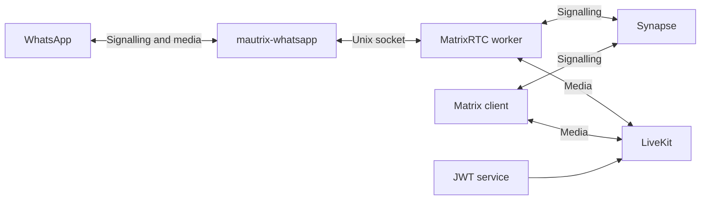

# Architecture

The existing mautrix-whatsapp bridge manages WhatsApp sessions, portals and messages. The call extension handles WhatsApp signalling and connects to the Rust MatrixRTC worker over a Unix socket. The worker joins LiveKit using persistent Matrix ghost identities.

## Services

| Service | Role |
| --- | --- |
| `mautrix-whatsapp` | Messaging, WhatsApp calling and portal management |
| `mautrix-whatsapp-call-worker` | MatrixRTC signalling and encrypted media |
| `mautrix-whatsapp-call-provisioner` | Persistent ghost identity provisioning |
| `livekit` | Media forwarding (SFU) |
| `lk-jwt-service` | LiveKit access tokens |
| `synapse` | Existing Matrix homeserver |

The bridge and worker share `/run/mautrix-whatsapp-call/worker.sock` (mode `0660`). Only the provisioner receives the mautrix-whatsapp appservice registration.

## Group calls

The default group topology uses one aggregate bridge participant and one admitted Matrix endpoint. Audio is mixed and one WhatsApp video source is selected at a time. Independent group media is experimental and disabled by default. See [client compatibility](CLIENT-CALL-COMPATIBILITY.md).

## Storage

The deployment stores generated credentials in `generated/` and persistent ghost identity state in `worker-state/`. Both must be preserved during upgrades.
